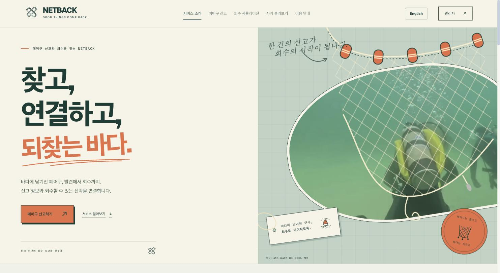
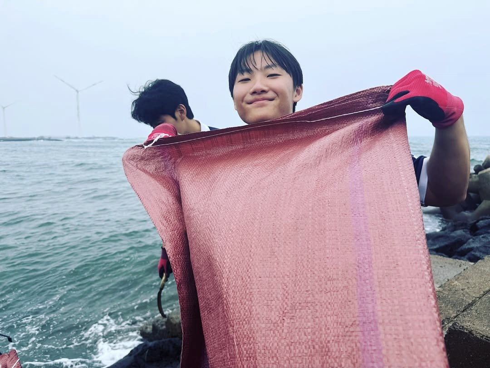
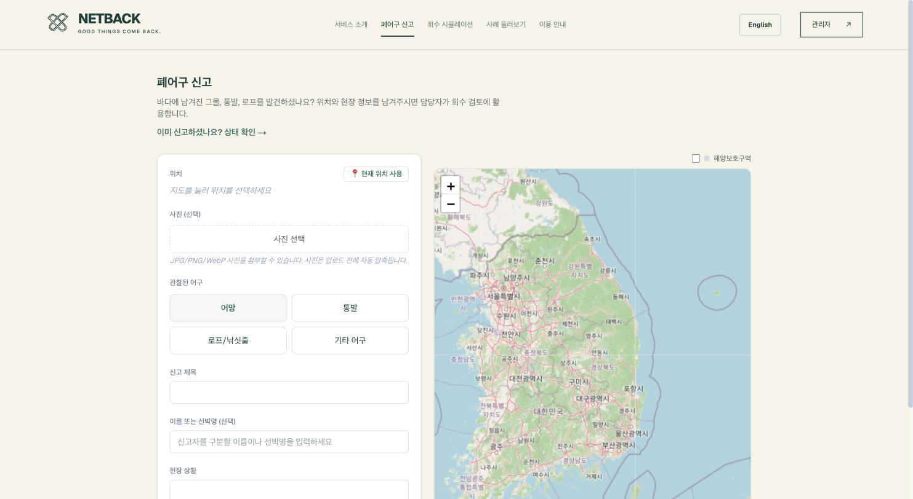
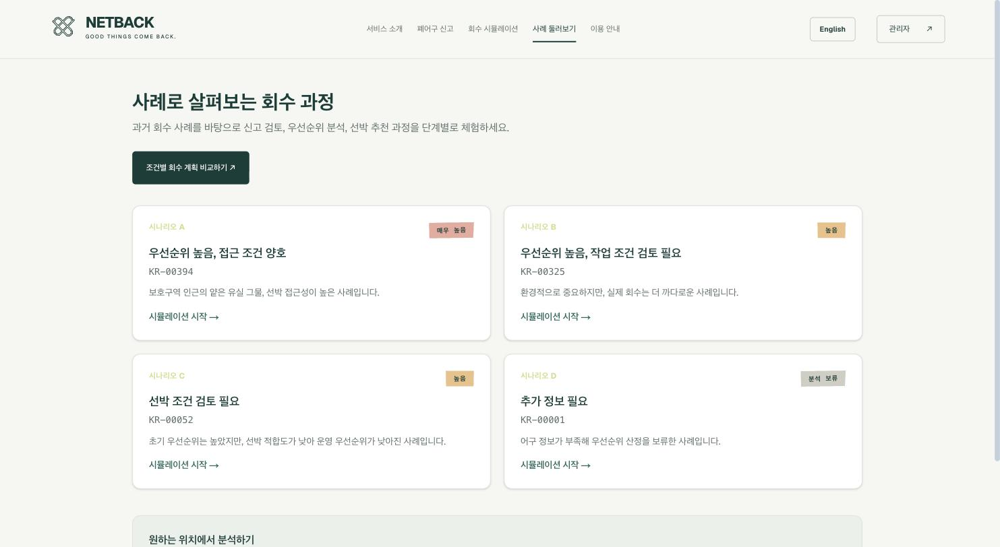
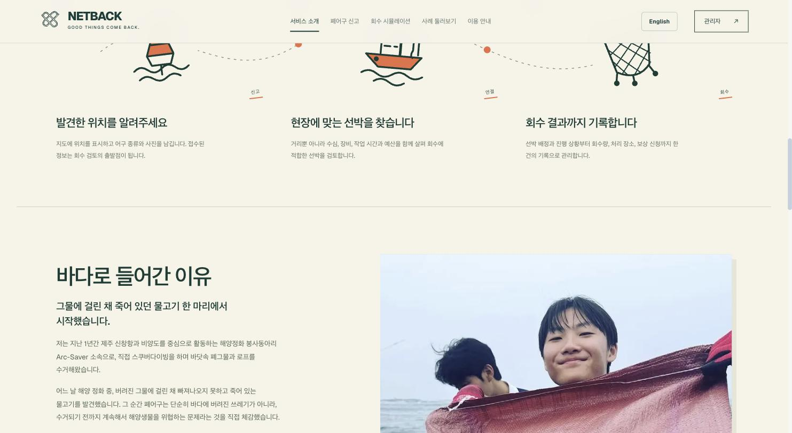

# NETBACK


NETBACK is a web app for coordinating ghost-gear recovery along the Korean coast — from a public "I found abandoned fishing gear here" report, through priority scoring and vessel matching, to a recorded recovery outcome and (if applicable) buyback compensation.



I started building this after a cleanup dive with Arc-Saver (a volunteer marine-cleanup crew based at Sinchang Harbor and Biyang Island, Jeju) where we found a fish that had died tangled in an abandoned net. After the dive there was no real way to record what we'd found, where, or what happened to it afterward — that's the gap this project tries to close.



Live: https://netback-app.vercel.app

## What's actually in here

- **Public report flow** (`/report`) — map location picker, "use my current location", gear type, an optional photo (auto-compressed client-side, with an experimental net/not-net classifier via a hosted Roboflow model), and a status page to check on a submitted report later.

  

- **Recovery priority engine** — scores a location on gear hazard, protected-area proximity, and seabed depth recoverability, then matches it against a fleet of candidate vessels by distance, tonnage and working limits. The live version (`lib/liveEngine/`) is a TypeScript port of an earlier Python prototype (`scripts/analyze_report.py`), rewritten so it can actually run on Vercel instead of shelling out to a Python process.
- **Admin operations dashboard** (`/admin/operations`, password-gated) — review a report, match it to a vessel, record the recovery outcome, classify it as a real field recovery vs. a test record, and log buyback compensation (rate × recovered weight, with request/approve/paid states).
- **GIS + impact page** (`/admin/gis`) — a density heatmap built from 178 historical recovery records, overlaid with confirmed field recoveries, plus aggregate stats (weight recovered, compensation paid, % near a protected area) computed live from the spatial engine.
- **Simulation lab** (`/lab`, `/simulate`) — a counterfactual planning tool over the historical dataset: change budget, fleet size, weather assumptions, etc. and see how the recommended allocation changes. Not real-time dispatch, just a what-if exercise.

  

- Full Korean/English UI (`lib/i18n`), mobile layout, PWA manifest.

  

## Data

- **178 historical ghost-gear recovery records** (Korea, 2021–), with region, gear material, recovery date and vessel type — `public/data/jobs.json`.
- **Marine protected area boundaries** from Korea's marine environment agency (KOEM), repaired/simplified for distance calculations — `public/data/marine_protected_areas.geojson` and the full-precision version in `data/mpa_polygons.json`.
- **GEBCO global bathymetry grid** for seabed depth at any coordinate — `data/gebco.tif`, sampled server-side via the `geotiff` package.
- **Historical vessel track points** (~484k points) used as a proxy for which vessels realistically operate near a given location — `data/vessel_track_points.json`.
- **Gear hazard priors** from a Norwegian catch-observation study on ghost-gear types, used as the evidence basis for the gear-hazard score (see `lib/liveEngine/formulas.ts` for the exact table and source labels — the model is explicit about which gear types have real evidence behind their hazard score and which don't).

The preprocessing scripts that produced the derived datasets above are in `scripts/` (Python) — coordinate reprojection (EPSG:4326 → EPSG:5179), MPA polygon repair, vessel-point export, etc.

## Priority model (v1)

```
mpa_proximity_score      = 0.10 + 0.90 * exp(-distance_km / 5)      (1.0 if inside the MPA)
depth_recoverability     = exp(-depth_m / 200)
environmental_priority   = 0.6 * gear_hazard_prior + 0.4 * mpa_proximity_score
route_proximity          = exp(-distance_km / 5)
tonnage_capacity_proxy   = 1 - exp(-tonnage_t / 10)
vessel_suitability       = 0.7 * route_proximity + 0.3 * tonnage_capacity_proxy
final_priority           = environmental_priority * depth_recoverability * vessel_suitability
```

These are intentionally simple, explainable multiplicative formulas — every score shown in the UI has a visible breakdown (see the priority-engine trace on `/simulate/[scenario]`), and the coordinate-level live engine (`lib/liveEngine/analyze.ts`) produces byte-for-byte identical output to the original Python reference implementation.

## Stack

Next.js 16 (App Router) + React 19 + TypeScript, Tailwind v4, Leaflet/react-leaflet for maps, Neon Postgres for the shared operations backend (reports, fleet, compensation), signed-cookie session auth for the admin area, deployed on Vercel.

## Running locally

```sh
npm install
npm run dev
```

You'll need a `.env.local` with `DATABASE_URL` / `DATABASE_URL_UNPOOLED` (Neon Postgres), `ADMIN_PASSWORD`, `SESSION_SECRET`, and `ROBOFLOW_API_KEY` if you want the photo classifier to work. Run `node db/migrate.mjs` once to set up the schema.

```sh
npx tsc --noEmit
node tests/operations.test.mjs
npm run build
```

## Known limitations

- The lab/simulation tool is a counterfactual exercise over historical data, not a live dispatch system — vessel qualification and availability are stated assumptions, not verified.
- Gear hazard priors only have real evidence behind net-type gear; other gear categories fall back to a general baseline and the UI says so explicitly rather than pretending otherwise.
- The photo classifier is scoped to "net vs. not-net" only — its training data doesn't support reliably distinguishing trap/rope/other gear, so it doesn't try to.

## Credit

Homepage/story section photos and video: Arc-Saver (Jeju Sea Ranch Dive Resort).
